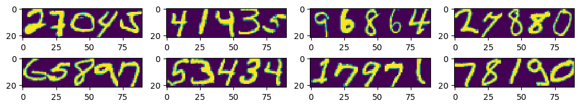

# Multi-Digit Handwritten Number Recognition Using CNN

A computer vision / deep learning project that uses **MNIST** to generate synthetic **five-digit handwritten numbers** and trains a **convolutional neural network (CNN)** to recognize each digit.

This repository is a cleaned, documented, and technically revised version of a university coursework notebook.



*Sample synthetic images from the original coursework notebook.*

## Project overview

Rather than recognizing a single handwritten digit, this project concatenates five MNIST digit crops to form an image representing a five-digit number. The model predicts all five digits in order.

**Pipeline:**

1. Load and visualize MNIST handwritten digits.
2. Crop each digit to 22 × 18 pixels and concatenate five crops into a 22 × 90 image.
3. Sample a nonzero first digit (1–9) and four remaining digits (0–9).
4. Create distinct training, validation, and test datasets.
5. Normalize images and train a CNN.
6. Plot training and validation loss / per-digit accuracy.
7. Evaluate both **per-digit accuracy** and **exact five-digit sequence accuracy** on the held-out test set.
8. Compare predictions with ground-truth labels visually.

## Dataset

- **Source:** [MNIST (Keras dataset)](https://keras.io/api/datasets/mnist/), 60,000 training and 10,000 test images of individual handwritten digits.
- **Generated samples:** 51,000 training, 9,000 validation, and 10,000 test images by default.
- **Input image shape:** `(22, 90, 1)` (grayscale).
- **Target:** 5 ordered digit classes in the range 0–9.
- **No leading zeros:** the first digit is sampled from classes 1–9.
- **Leakage precaution:** original MNIST training images are split into disjoint training/validation source sets **before** generating multi-digit examples. MNIST's official test images are held out for testing.

The dataset is downloaded automatically the first time you run `keras.datasets.mnist.load_data()`; no MNIST files are committed to this repository.

## Model

The model contains two convolutional layers (64 and 128 filters), LeakyReLU activations, dropout, and a final categorical output of shape `(5, 10)` for five digit positions and ten digit classes. It is trained using **sparse categorical cross-entropy** and Adam optimization with early stopping.

**Metrics:**

- **Per-digit accuracy:** fraction of correctly predicted digit positions across all images.
- **Exact-sequence accuracy:** fraction of images for which all five positions are predicted correctly (a stricter metric).

## Run locally or in Google Colab

**Requirements:** Python 3.10+ recommended, TensorFlow, NumPy, Matplotlib, scikit-learn, and Jupyter. A GPU is optional but helpful for training.

```bash
python -m venv .venv
# Linux / macOS:
source .venv/bin/activate
# Windows PowerShell:
# .venv\Scripts\Activate.ps1

pip install -r requirements.txt
jupyter notebook multidigit_mnist.ipynb
```

Alternatively, upload `multidigit_mnist.ipynb` to [Google Colab](https://colab.research.google.com/) and run the cells from top to bottom. Set **Runtime → Change runtime type → GPU** if available. If using Colab, install any missing dependencies as needed.

Training uses 20 maximum epochs by default, with early stopping. Reduce `TRAIN_SAMPLES` and `EPOCHS` for quicker experiments.

## Repository contents

```text
multidigit-mnist-github/
├── multidigit_mnist.ipynb   # Cleaned, annotated end-to-end notebook
├── assets/five_digit_samples.png # Sample visualization
├── README.md                # Project documentation
├── requirements.txt         # Python dependencies
├── .gitignore               # Excluded local and generated files
└── GITHUB_AND_CV_TEXT.md    # Ready-to-use project descriptions
```

## Changes from the original coursework notebook

The initial notebook scaled digit labels by 255 and treated the five output values as binary cross-entropy targets. The resulting built-in accuracy metric did **not** directly measure correct five-digit recognition. This updated notebook uses **integer digit labels, categorical predictions for each digit**, and computes **exact-sequence accuracy** explicitly. It also removes unused imports, creates reusable preprocessing functions, adds deterministic sampling, and separates source images before validation to reduce leakage.

These are **modeling changes**, not just cosmetic refactoring, so reported performance from the original notebook should not be directly compared with results from this version.

## Results and limitations

No benchmark number is included because the cleaned version has **not been trained and evaluated for this repository release**. Running the notebook prints the actual test metrics and displays predictions.

Images are synthetic concatenations of MNIST digits. They do not fully represent real-world multi-digit handwriting (spacing, noise, touching digits, or varied layouts). Cropping may also remove strokes near the edges.

## License and attribution

This is a university coursework project built with the publicly available MNIST dataset via Keras. No dataset images are stored in this repository. Add a license only if you have the right to release the code under its terms.
